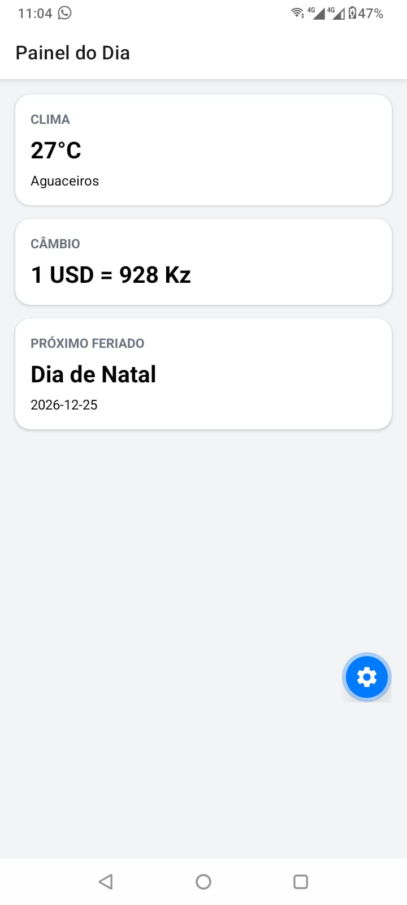
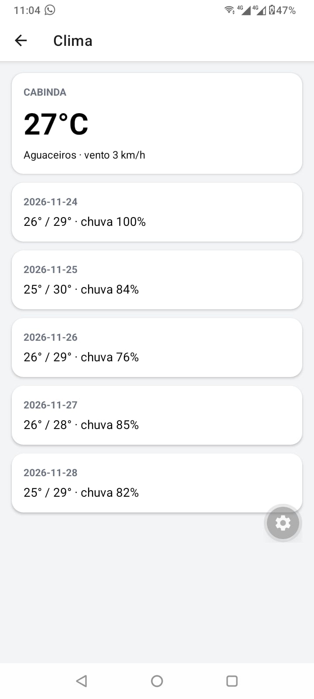
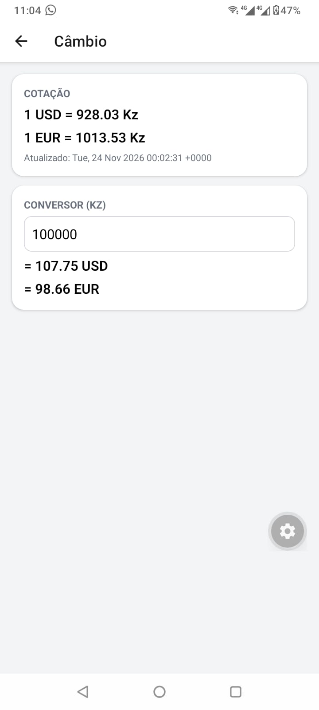
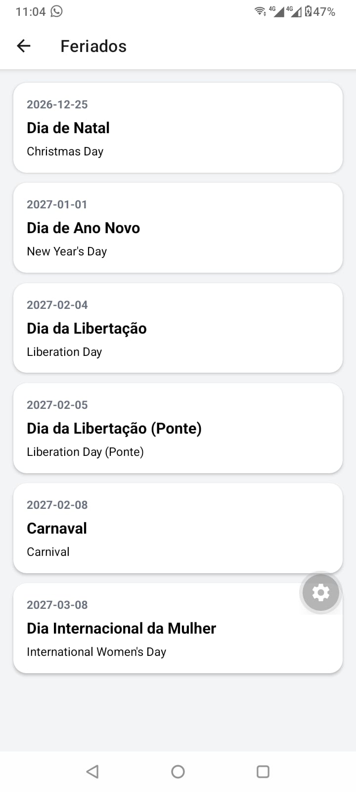

<div align="center">


# Painel do Dia

**Clima, câmbio do Kwanza e feriados nacionais num só ecrã.**

Aplicação móvel feita com React Native e Expo que consome APIs públicas e gratuitas, sem backend e sem chaves de acesso.


</div>

---

## Sobre o projeto

O **Painel do Dia** reúne as informações que se consultam todos os dias em Angola num único painel: a temperatura e a previsão do tempo, a cotação do Kwanza (Kz) face ao dólar e ao euro, e os próximos feriados nacionais.

O projeto foi pensado para ser simples de manter. Não existe servidor próprio nem base de dados: toda a informação vem de APIs abertas, o que reduz custos e complexidade e torna o app fácil de estudar, executar e evoluir.

## Funcionalidades

- **Painel inicial** com o resumo do clima, do câmbio e do próximo feriado, cada cartão a abrir o respetivo detalhe.
- **Clima**: temperatura atual, descrição do tempo, velocidade do vento e previsão para 5 dias (mínima, máxima e probabilidade de chuva).
- **Câmbio**: cotação de USD e EUR em Kwanzas, com data da última atualização e conversor de Kz para USD e EUR.
- **Feriados**: lista dos próximos feriados nacionais, com nome local e nome internacional.
- **Estados de carregamento e erro** em todos os ecrãs, com botão para tentar novamente.
- **Sem backend e sem chaves de API.**

## Capturas de ecrã

<div align="center">

| Início | Câmbio | Clima | Feriados |
|:------:|:------:|:-----:|:--------:|
|  |  |  |  |

</div>

## Tecnologias

| Área | Tecnologia |
|------|------------|
| Framework | [React Native](https://reactnative.dev/) com [Expo](https://expo.dev/) |
| Navegação | [Expo Router](https://docs.expo.dev/router/introduction/) (rotas baseadas em ficheiros) |
| Linguagem | TypeScript (ecrãs e componentes) e JavaScript (serviços e hooks) |
| Dados | `fetch` nativo com um hook reutilizável (`useFetch`) |
| Build | [EAS Build](https://docs.expo.dev/build/introduction/) para gerar o APK |

## APIs utilizadas

Todas gratuitas e sem necessidade de registo ou chave:

| Dados | API | Documentação |
|-------|-----|--------------|
| Clima e previsão | Open-Meteo | https://open-meteo.com/ |
| Câmbio (USD, EUR e AOA) | ExchangeRate-API (endpoint aberto) | https://www.exchangerate-api.com/docs/free |
| Feriados nacionais | Nager.Date | https://date.nager.at/ |

> Taxas de câmbio fornecidas por [ExchangeRate-API](https://www.exchangerate-api.com). Dados meteorológicos por [Open-Meteo](https://open-meteo.com/). Os valores de câmbio são de referência e podem diferir das taxas praticadas pelos bancos e casas de câmbio.

## Estrutura do projeto

```
painelDoDia/
├── src/
│   ├── app/            # Ecrãs e rotas (index, cambio, clima, feriados)
│   ├── components/     # Componentes reutilizáveis (Cartao, Carregando, Erro)
│   ├── hooks/          # Hooks personalizados (useFetch)
│   ├── services/       # Chamadas às APIs (cambio, clima, feriados)
│   └── assets/         # Ícones, imagens e capturas de ecrã
├── app.json            # Configuração do Expo
├── package.json
└── tsconfig.json
```

A separação é intencional: os **serviços** só falam com as APIs e devolvem dados tratados, o **hook** `useFetch` gere carregamento e erro, e os **ecrãs** apenas apresentam o resultado.

## Como executar

### Pré-requisitos

- [Node.js](https://nodejs.org/) 18 ou superior
- Aplicação **Expo Go** no telemóvel ([Android](https://play.google.com/store/apps/details?id=host.exp.exponent) / [iOS](https://apps.apple.com/app/expo-go/id982107779))

### Instalação

```bash
# 1. Clonar o repositório
git clone https://github.com/SEU-USUARIO/painelDoDia.git
cd painelDoDia

# 2. Instalar as dependências
npm install

# 3. Iniciar o servidor de desenvolvimento
npx expo start
```

Leia o QR code com o Expo Go (o telemóvel deve estar na mesma rede Wi-Fi do computador). Se a ligação falhar, use:

```bash
npx expo start --tunnel
```

### Mudar a cidade do clima

A cidade está definida em `src/services/clima.js`. Basta alterar o nome e as coordenadas:

```js
const LOCAL = { nome: 'Cabinda', latitude: -5.5602, longitude: 12.1906 };
```

## Gerar o APK para Android

O projeto usa o EAS Build para criar um APK instalável diretamente no telemóvel.

```bash
npx eas-cli login
npx eas-cli build:configure
npx eas-cli build -p android --profile preview
```

No fim do processo é gerado um link para descarregar e instalar o `.apk`. O perfil `preview` está configurado no `eas.json` com `"buildType": "apk"`.

## Próximos passos

- [ ] Escolher a cidade dentro do app
- [ ] Guardar a última resposta para consulta sem internet (AsyncStorage)
- [ ] Mais moedas no conversor
- [ ] Alertas de feriados próximos
- [ ] Tema escuro personalizado

## Contribuir

Sugestões e melhorias são bem-vindas. Para contribuir:

1. Faça um fork do projeto
2. Crie uma branch: `git checkout -b minha-melhoria`
3. Faça commit das alterações: `git commit -m "Descrição da melhoria"`
4. Envie para o seu fork: `git push origin minha-melhoria`
5. Abra um Pull Request

## Licença

Distribuído sob a licença indicada no ficheiro [LICENSE](LICENSE).

## Autor

**Horácio Manuel** · *manuelldesigner*

Desenvolvedor de software e designer gráfico em Cabinda, Angola.

- Instagram: [@manuelldesigner](https://instagram.com/manuelldesigner)
- GitHub: [@SEU-USUARIO](https://github.com/SEU-USUARIO)

---

<div align="center">

Feito em Angola 🇦🇴

</div>